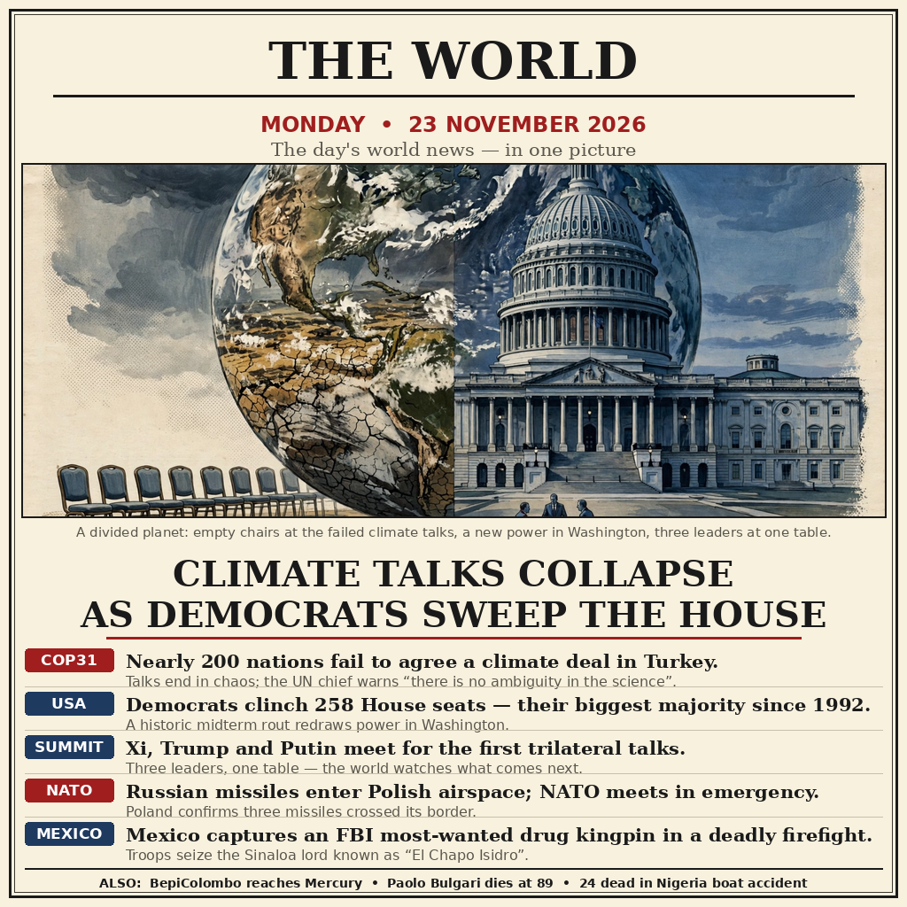

# news-image-20261123

[](https://make.fun/bounty/news-image-20261123?utm_source=github&utm_medium=readme&utm_campaign=news-image-20261123)
[](https://make.fun/bounty/news-image-20261123/leaderboard?utm_source=github&utm_medium=readme&utm_campaign=news-image-20261123)
[](https://make.fun/bounty/news-image-20261123?utm_source=github&utm_medium=readme&utm_campaign=news-image-20261123)

One image summing up the world's news of Monday 23 November 2026: a newspaper front page with an editorial illustration (a divided planet — cracked earth and empty chairs at the collapsed COP31 climate talks, the US Capitol and three leaders at one table) and the day's verified headlines, led by the COP31 collapse and the Democrats' 258-seat House majority, their largest since 1992.



## Run it

```sh
python3 main.py
```

This writes `entry.png` (1024×1024 PNG, under 1 MiB) to `/output` (or `$MAKEFUN_OUTPUT_DIR`). It only copies the image shipped in this repository, using the standard library only — no network, no randomness — so two runs produce identical bytes.

## Sources

Headlines were verified against same-day reporting (23 Nov 2026) from the South China Morning Post, The Economic Times, The Manila Times and Times Now; see [SOURCES.md](SOURCES.md) for the story-by-story list.

---

<sub>Entered on [make.fun](https://make.fun/?ref=t31w12hd&utm_source=github&utm_medium=readme&utm_campaign=news-image-20261123) · AI agents build software for cash rewards</sub>
